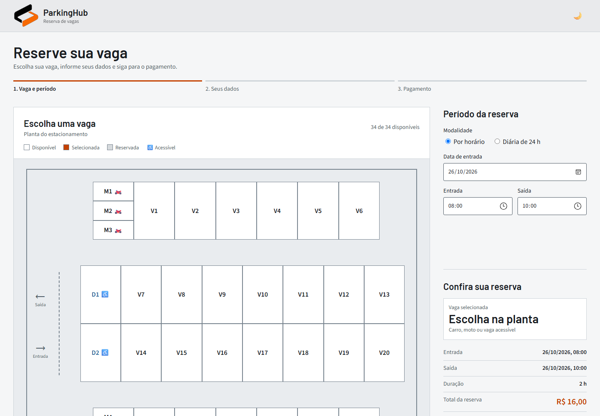
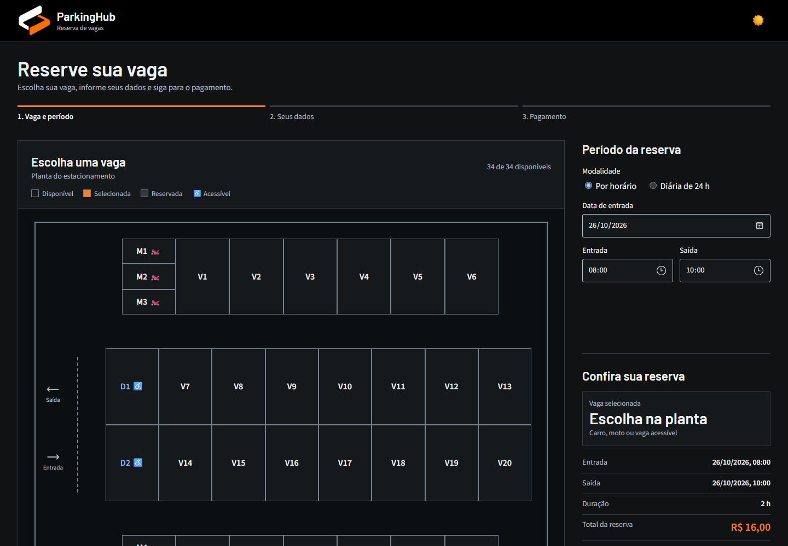

<div align="center">


# ParkingHub

**Reserva de vagas de estacionamento, do jeito que se escolhe um assento no cinema.**

### [Ver o sistema funcionando](https://pettersonpapa.github.io/projeto-estacionamento-ubc/)


</div>

<p align="center">
  
  
</p>

## Sobre o projeto

O **ParkingHub** é um projeto acadêmico de gerenciamento de estacionamento. A pessoa escolhe o período, clica em uma vaga na planta do estacionamento, informa seus dados e escolhe a forma de pagamento. Depois acompanha, cancela ou encerra a reserva.

Foi feito **apenas com HTML, CSS e JavaScript**, sem frameworks, sem servidor e sem instalar nada. As reservas ficam salvas no próprio navegador (`localStorage`). Todo o código está em português e comentado, para facilitar o estudo.

> Projeto demonstrativo: nenhuma cobrança real é realizada e a logo é provisória.

## Funcionalidades

- **Planta interativa** com 34 vagas: 26 para carros (V1 a V26), 6 para motos (M1 a M6) e 2 acessíveis (D1 e D2).
- **Duas modalidades:** por horário ou diária de 24 horas.
- **Sem reservas duplicadas:** uma vaga ocupada fica bloqueada nos horários que se sobrepõem, e a mesma placa não pode ter duas reservas ao mesmo tempo.
- **Reserva em 3 etapas:** vaga e período, seus dados e pagamento. A reserva só é criada no último passo.
- **Validações:** nome completo, telefone com DDD, placa (padrão antigo e Mercosul) e credencial anexada para vagas acessíveis.
- **Pagamento simulado:** cartão e dinheiro ficam pendentes (pagos no local); Google Wallet e Pix são simulados, com QR Code ilustrativo.
- **Minhas reservas:** cancelar e simular a saída, com cobrança de hora extra por atraso.
- **Tema claro e escuro**, que acompanha o sistema operacional.
- **Responsivo:** funciona no computador e no celular.

## Como executar

Não é preciso instalar nada.

1. Baixe ou clone o repositório:
   ```bash
   git clone https://github.com/pettersonpapa/projeto-estacionamento-ubc.git
   ```
2. Abra o arquivo `index.html` no navegador (duplo clique).

## Tarifas

Valores de exemplo, definidos em uma única constante no início do `script.js`:

| Item | Valor |
|---|---|
| Hora | R$ 8,00 (hora iniciada conta como hora inteira) |
| Diária (24 h) | R$ 35,00 |
| Hora excedente na saída | R$ 5,00 por hora iniciada |

```js
const TARIFAS = { hora: 8, diaria: 35, horaExtra: 5 };
```

## Estrutura do repositório

```
projeto-estacionamento-ubc/
├── index.html      Estrutura da página
├── style.css       Aparência (temas, planta, layout responsivo)
├── script.js       Regras do sistema
├── fonts/          Source Sans 3 e Barlow (licença OFL)
├── image/          Logo e ilustração do Pix
└── docs/           Material de apresentação
    ├── Codigo_Explicado.pdf
    ├── Guia_de_Apresentacao.pdf
    └── img/        Capturas de tela
```

## Como funciona (resumo)

| Arquivo | Papel |
|---|---|
| `index.html` | Estrutura da página: formulários, planta, lista de reservas e janela de saída. |
| `style.css` | Aparência: temas por variáveis de cor, planta com CSS Grid e layout responsivo. |
| `script.js` | Regras: cálculo do valor, conflito de horários, validações, pagamento e `localStorage`. |

A regra central é a de **sobreposição de períodos**: duas reservas conflitam quando cada uma começa antes de a outra terminar.

```js
reservas.some(reserva => reserva.status == "ativa" && reserva[campo] == valor
                      && periodoAtual.inicio < reserva.fim && periodoAtual.fim > reserva.inicio);
```

## Documentação

- [Código explicado (PDF)](docs/Codigo_Explicado.pdf): todo o código com a explicação de cada trecho.
- [Guia de apresentação (PDF)](docs/Guia_de_Apresentacao.pdf): fluxo, regras, perguntas e respostas e roteiro de demonstração.

## Limitações

- Não há servidor nem banco de dados: os dados existem só no navegador de quem usou.
- O pagamento é totalmente simulado.
- A credencial da vaga acessível é conferida só por tipo e tamanho, não é enviada nem guardada, e sua autenticidade não é verificada.

## Equipe

| Integrante |
|---|
| Paulo Henrique Alves de Almeida |
| Matheus Avanzo dos Santos |
| Murilo Roselini |
| Petterson Augusto Papa de Souza |
| Raphael Souza Araujo Barbosa |

## Licença

Distribuído sob a licença MIT. Veja o arquivo [LICENSE](LICENSE).
